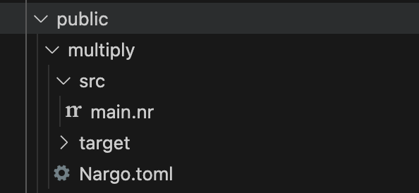
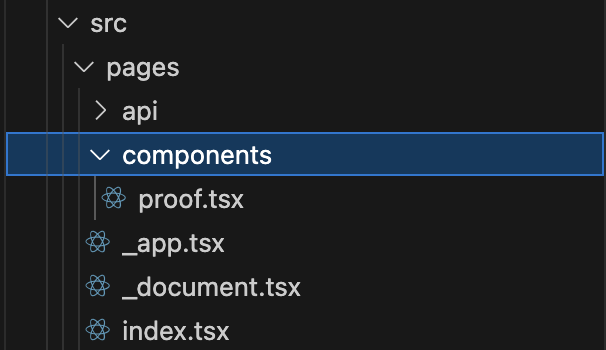
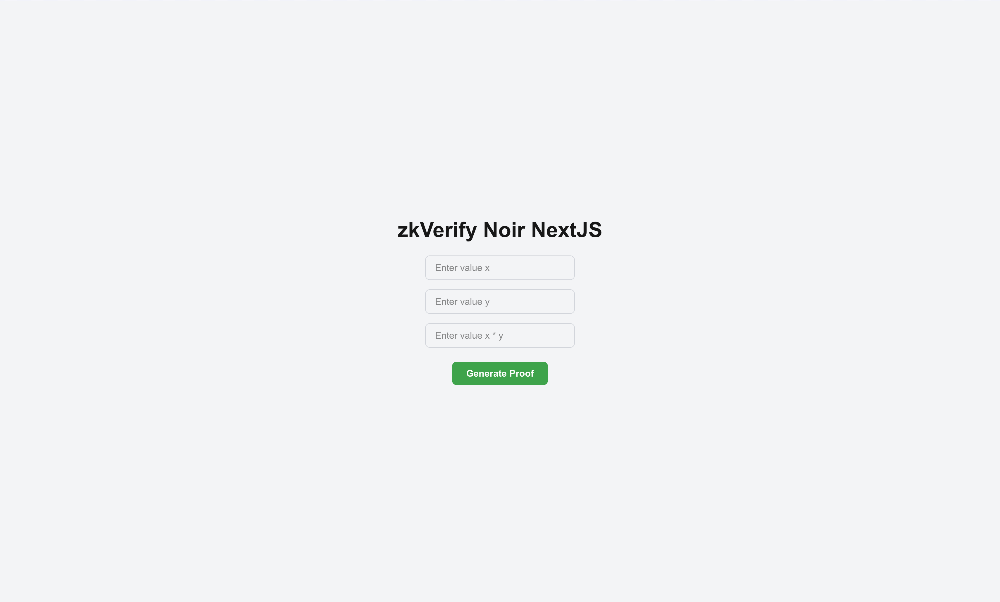
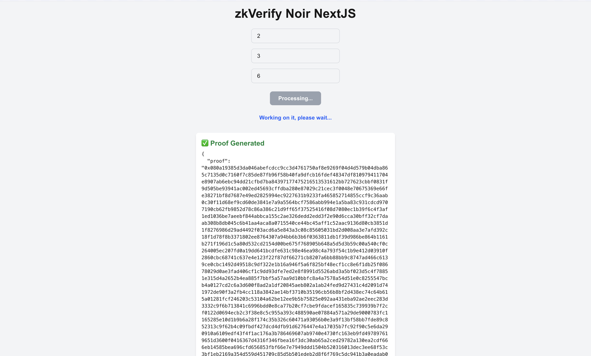
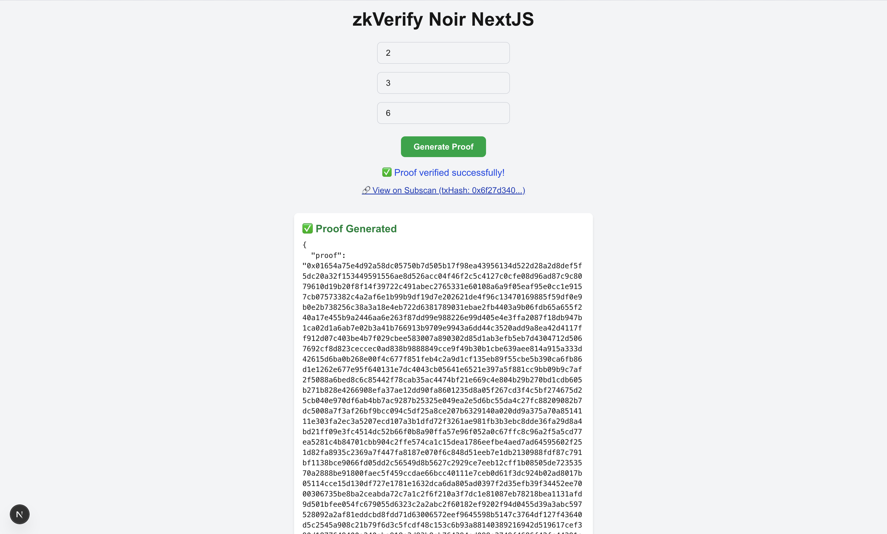

:::info
All the codebase used in the tutorial can be explored [here](https://github.com/zkVerify/tutorials/tree/main/nextjs-noir)
:::

This guide will walk you through the process of developing a NextJS application with client side proving supported by Noir and verifying the proofs with [Kurier](../02-getting-started/05-kurier.md). We will start from scratch by developing a simple `Noir` circuit and then using `bbjs` to generate proofs on the client side.

This tutorial uses Node.js `24.3.0`, Next.js `16.4.6`, Noir `1.0.0-beta.6` and Barretenberg `0.84.0`.

To start this tutorial, we will create our NextJS application using the following command:
```bash
npx create-next-app@16.4.6
```

While creating a new NextJS application you will get the following options:

```bash
What is your project named? my-app
Would you like to use the recommended Next.js defaults? # Select No, customize settings
Would you like to use TypeScript? No / Yes # Select yes
Which linter would you like to use? ESLint / Biome / None # Select ESLint
Would you like to use React Compiler? No / Yes # Select no
Would you like to use Tailwind CSS? No / Yes # Select yes
Would you like your code inside a `src/` directory? No / Yes # Select yes
Would you like to use App Router? (recommended) No / Yes # Select no
Would you like to customize the import alias (`@/*` by default)? No / Yes # Select no
Would you like to include AGENTS.md to guide coding agents to write up-to-date Next.js code? No / Yes # Select no
Would you like to help improve Next.js by letting agents prepare anonymized feedback for your review as you code? No / Yes # Select no
```

We would also like to install few required packages for our application namely `axios`, `@noir-lang/noir_js` and `@aztec/bb.js`. First, we will go inside the project directory and run the npm install command.

```bash
cd my-app
```

```bash
npm i axios @noir-lang/noir_js@1.0.0-beta.6 @aztec/bb.js@0.84.0
```

Before creating the circuit, install [noirup](https://noir-lang.org/docs/getting_started/noir_installation) if it is not already available. Use it to install the Noir compiler version matching `@noir-lang/noir_js`:

```bash
noirup -v 1.0.0-beta.6
nargo --version
```

Check that `nargo --version` reports `1.0.0-beta.6`.

Next, open your NextJS app in any IDE you like. And explore the folder structure of your NextJS application. Inside the public folder we will create a new `Noir` project. Use the following command:

```bash
cd public
```

```bash
nargo new multiply
```

Inside the `src` folder under `multiply` you will find `main.nr` file. We won’t be diving deep into Noir, but we will explore all the required code snippets. We will design a simple circuit, which takes three inputs(x,y,z) and constraints that `z === (x*y)`. Replace the content of that file with the following code snippet:

```noir
fn main(x: Field, y: Field, z: pub Field) {
    assert(z == x*y);
}
```

Next we will compile our project, move inside the `multiply` folder and use `nargo` to compile. Use the following commands:

```bash
cd multiply
```

```bash
nargo compile
```

Your public directory, should look similar as following:



Return to the NextJS project directory:

```bash
cd ../..
```

Also create a new file named `.env` in the main project directory to store the Kurier API key which will be later used to verify proofs. Sign up at [Kurier testnet](https://testnet.kurier.xyz) and copy your testnet API key. Keep this file private and do not commit it. Use the following code snippet:

```bash
API_KEY="your-testnet-api-key"
```

Now let's create a backend API in our NextJS application which will take the proof artifacts as inputs to verify our proof with Kurier. This API will be used by our frontend to verify the proofs generated on the client side. Create a new file named `kurier.ts` inside `src/pages/api`.

First we will import all the required packages for HTTP requests and file handling for our backend application. Next we create a handler function which takes `POST` API calls to verify proofs with proof artifacts passed as the body of the API request. We will declare the `API_URL` for Kurier. We also need to create a `concatenatePublicInputsAndProof()` function to format our `Ultraplonk` proof into the required format needed by Kurier.

Before sending the proof for verification, we will register our verification key. This process is needed once per verification key and it decreases the cost of proof verification. After registering the verification key, we call the Kurier API endpoints to submit our proof for verification and to poll the status of proof verification. Once we get the `IncludedInBlock` event, we return the tx data to the frontend. You can check the [Kurier tutorials here](../02-getting-started/05-kurier.md).

```ts
import axios from "axios";
import { NextApiRequest, NextApiResponse } from "next";
import { Buffer } from "buffer";
import fs from "fs";
import path from "path";

const API_URL = "https://api-testnet.kurier.xyz/api/v1";

export default async function handler(req: NextApiRequest, res: NextApiResponse){

    if (req.method !== 'POST') {
      return res.status(405).json({ error: 'Method not allowed' });
    }
    try{
        if (!process.env.API_KEY) {
          return res.status(500).json({ error: "Set API_KEY in the project .env file." });
        }

        const proofUint8 = new Uint8Array(Object.values(req.body.proof));

        const vkPath = path.join(process.cwd(), "public", "multiply", "vkey.json");
        let vk = fs.existsSync(vkPath) ? JSON.parse(fs.readFileSync(vkPath, "utf-8")) : null;
        if (!(vk?.vkHash || vk?.meta?.vkHash)) {
          await registerVk(req.body.vk);
          vk = JSON.parse(fs.readFileSync(vkPath, "utf-8"));
        }

        const params = {
            "proofType": "ultraplonk",
            "vkRegistered": true,
            "proofOptions": {
                "numberOfPublicInputs": 1
            },
            "proofData": {
                "proof": Buffer.from(concatenatePublicInputsAndProof(req.body.publicInputs, proofUint8)).toString("base64"),
                "vk": vk.vkHash || vk.meta.vkHash,
            }
        }

        const requestResponse = await axios.post(`${API_URL}/submit-proof/${process.env.API_KEY}`, params, { timeout: 30000 })
        console.log("Proof submission HTTP status:", requestResponse.status)

        if (requestResponse.data.optimisticVerify === "failed") {
            return res.status(422).json({ error: "Proof verification failed. Check the proof artifacts." });
        }
        if (!requestResponse.data.jobId) {
            return res.status(502).json({ error: "Kurier did not return a job ID." });
        }

        for (let attempt = 0; attempt < 24; attempt++) {
          try{
            const jobStatusResponse = await axios.get(`${API_URL}/job-status/${process.env.API_KEY}/${requestResponse.data.jobId}`, { timeout: 30000 });
            console.log("Job status:", jobStatusResponse.data.status);
            if(jobStatusResponse.data.status === "IncludedInBlock"){
                console.log("Job Included in Block successfully");
                res.status(200).json(jobStatusResponse.data);
                return;
            }else{
                console.log("Job status: ", jobStatusResponse.data.status);
                console.log("Waiting for job to finalize...");
                await new Promise(resolve => setTimeout(resolve, 5000)); // Wait for 5 seconds before checking again
            }
          } catch (error) {
            if (axios.isAxiosError(error) && error.response?.status === 503) {
              console.log("Service Unavailable, retrying...");
              await new Promise(resolve => setTimeout(resolve, 5000)); // Wait for 5 seconds before retrying
            } else {
              throw error;
            }
          }
        }
        return res.status(504).json({ error: "Timed out waiting for Kurier verification." });
    } catch (error) {
        const status = axios.isAxiosError(error) ? error.response?.status : undefined;
        console.log("Kurier request failed; HTTP status:", status ?? "unavailable");
        return res.status(502).json({ error: status === 401
          ? "Kurier rejected the API key (401). Check the key from testnet.kurier.xyz in .env."
          : "Kurier verification request failed. Please try again." });
    }
}

function hexToUint8Array(hex: string) {
  if (hex.startsWith('0x')) hex = hex.slice(2);
  if (hex.length % 2 !== 0) hex = '0' + hex;

  const bytes = new Uint8Array(hex.length / 2);
  for (let i = 0; i < bytes.length; i++) {
    bytes[i] = parseInt(hex.substr(i * 2, 2), 16);
  }
  return bytes;
}

function concatenatePublicInputsAndProof(publicInputsHex: string[], proofUint8: Uint8Array) {
  const publicInputBytesArray = publicInputsHex.flatMap((hex: string) =>
    Array.from(hexToUint8Array(hex))
  );

  const publicInputBytes = new Uint8Array(publicInputBytesArray);

  console.log(publicInputBytes.length, proofUint8.length)

  const newProof = new Uint8Array(publicInputBytes.length + proofUint8.length);
  newProof.set(publicInputBytes, 0);
  newProof.set(proofUint8, publicInputBytes.length);

  return newProof;
}

async function registerVk(vk: string){

  const API_URL = "https://api-testnet.kurier.xyz/api/v1";

  const params = {
    proofType: "ultraplonk",
    vk: vk,
    proofOptions: {
      "numberOfPublicInputs": 1
    },
  };

  try{
    const res = await axios.post(
      `${API_URL}/register-vk/${process.env.API_KEY}`,
      params,
      { timeout: 30000 }
    )
    if (!res.data.vkHash) throw new Error("Kurier did not return a verification key hash");
    console.log("Verification key registered")
    fs.writeFileSync(
        path.join(process.cwd(), "public", "multiply", "vkey.json"),
        JSON.stringify(res.data)
      );
  } catch (error) {
    if (!axios.isAxiosError(error) || !error.response?.data?.meta?.vkHash) throw error;
    fs.writeFileSync(
        path.join(process.cwd(), "public", "multiply", "vkey.json"),
        JSON.stringify(error.response.data)
      );
  }
}
```

Now create a new sub directory named `components` under the `pages` directory inside the `src` folder. This folder will be used to store all the new components we will be building for our application. Create a new file named `proof.tsx` under the `components` directory.



Now we will go in detail about the proof component. First we will import `useState` from `react`, `UltraPlonkBackend` from `bbjs` and `Noir` from `noir_js`. We will declaring multiple useState, for maintaining state for our application. We will also declare a `handleGenerateProof()` to generate our proof, which uses the `UltraPlonkBackend.generateProof()` function to generate the UltraPlonk proof with our proof artifacts and inputs. Then we will call the Kurier backend API we created earlier in this tutorial for proof verification and update our state as per the results. We will use the return function to render all the UI components required for this proof component.

```tsx
"use client";

import { useState } from "react";
import { UltraPlonkBackend } from "@aztec/bb.js";
import { Noir } from "@noir-lang/noir_js";

export default function ProofComponent() {
  const [x, setX] = useState("");
  const [y, setY] = useState("");
  const [result, setResult] = useState("");

  const [isLoading, setIsLoading] = useState(false);
  const [proofResult, setProofResult] = useState<{ proof: string; publicInputs: string[] } | null>(null);
  const [errorMsg, setErrorMsg] = useState("");
  const [verificationStatus, setVerificationStatus] = useState("");
  const [txHash, setTxHash] = useState<string | null>(null);

  const handleGenerateProof = async () => {
    setIsLoading(true);
    setProofResult(null);
    setErrorMsg("");
    setVerificationStatus("");
    setTxHash(null);

    try {
      const circuit_json = await fetch("/multiply/target/multiply.json");
      const noir_data = await circuit_json.json();

      const input = {
        x: x,
        y: y,
        z: result,
      };
      const noir = new Noir(noir_data);
      const execResult = await noir.execute(input);
      console.log("Witness Generated:", execResult);

      const plonk = new UltraPlonkBackend(noir_data.bytecode, { threads: 2 });
      const { proof, publicInputs } = await plonk.generateProof(
        execResult.witness
      );
      const vk = await plonk.getVerificationKey();

      setProofResult({
        proof: "0x" + Buffer.from(proof).toString("hex"),
        publicInputs,
      });

      //   Send to backend for verification
      const res = await fetch("/api/kurier", {
        method: "POST",
        headers: {
          "Content-Type": "application/json",
        },
        body: JSON.stringify({
          proof: proof,
          publicInputs: publicInputs,
          vk: Buffer.from(vk).toString("base64"),
        }),
      });

      const data = await res.json();

      if (res.ok) {
        setVerificationStatus("✅ Proof verified successfully!");
        if (data.txHash) {
          setTxHash(data.txHash);
        }
      } else {
        setVerificationStatus(`❌ ${data.error || "Proof verification failed."}`);
      }
    } catch (error) {
      console.error("Error generating proof or verifying:", error);
      setErrorMsg(
        "❌ Error generating or verifying proof. Please check your inputs and try again."
      );
    } finally {
      setIsLoading(false);
    }
  };

  return (
    <div className="flex flex-col items-center justify-center min-h-screen bg-gray-100 p-4">
      <h1 className="text-4xl font-bold mb-6 text-black">zkVerify Noir NextJS</h1>

      {/* Inputs */}
      <div className="flex flex-col space-y-4 w-64 mb-6">
        <input
          type="number"
          placeholder="Enter value x"
          value={x}
          onChange={(e) => setX(e.target.value)}
          className="px-4 py-2 rounded-lg bg-white text-black placeholder-gray-500 border border-gray-300 focus:outline-none focus:ring-2 focus:ring-blue-500"
        />
        <input
          type="number"
          placeholder="Enter value y"
          value={y}
          onChange={(e) => setY(e.target.value)}
          className="px-4 py-2 rounded-lg bg-white text-black placeholder-gray-500 border border-gray-300 focus:outline-none focus:ring-2 focus:ring-blue-500"
        />
        <input
          type="number"
          placeholder="Enter value x * y"
          value={result}
          onChange={(e) => setResult(e.target.value)}
          className="px-4 py-2 rounded-lg bg-white text-black placeholder-gray-500 border border-gray-300 focus:outline-none focus:ring-2 focus:ring-blue-500"
        />
      </div>

      {/* Generate Proof Button */}
      <button
        onClick={handleGenerateProof}
        disabled={isLoading}
        className={`${
          isLoading
            ? "bg-gray-400 cursor-not-allowed"
            : "bg-green-600 hover:bg-green-700"
        } text-white font-semibold px-6 py-2 rounded-lg`}
      >
        {isLoading ? "Processing..." : "Generate Proof"}
      </button>

      {/* Loading */}
      {isLoading && (
        <div className="mt-6 text-blue-600 font-semibold">
          Working on it, please wait...
        </div>
      )}

      {/* Error Message */}
      {errorMsg && (
        <div className="mt-6 text-red-600 font-medium">{errorMsg}</div>
      )}

      {/* Verification Result */}
      {verificationStatus && (
        <div className="mt-4 text-lg font-medium text-blue-700">
          {verificationStatus}
        </div>
      )}

      {/* TX Hash */}
      {txHash && (
        <div className="mt-2 text-blue-800 underline">
          <a
            href={`https://zkverify-testnet.subscan.io/extrinsic/${txHash}`}
            target="_blank"
            rel="noopener noreferrer"
          >
            🔗 View on Subscan (txHash: {txHash.slice(0, 10)}...)
          </a>
        </div>
      )}

      {/* Output */}
      {proofResult && (
        <div className="mt-8 bg-white shadow-md p-4 rounded-lg w-full max-w-xl">
          <h2 className="text-xl font-bold mb-2 text-green-700">
            ✅ Proof Generated
          </h2>
          <pre className="text-sm text-black overflow-x-auto whitespace-pre-wrap break-words">
            {JSON.stringify(proofResult, null, 2)}
          </pre>
        </div>
      )}
    </div>
  );
}
```

Next open `src/pages/index.tsx` file to use our proof component. Replace the whole file content with the following code snippet:

```tsx
import ProofComponent from "./components/proof";

export default function Home() {
  return (
    <>
      <ProofComponent />
    </>
  );
}
```

Now we have completed all our steps for our NextJS application. You can start the application by running the following command:

```bash
npm run dev
```

You can open the url, you got in the terminal window and you should get the following screen:



Fill up the x, y and result field with any value you want where `result = x*y` and click on `Generate Proof` button. Once proof is generated it will shown below the button:



After proof generation, it will automatically send the proof for verification using Kurier and will show status `working on it `. Once the proof is verified, you will get the txHash and you can click on it to check it on our explorer.


